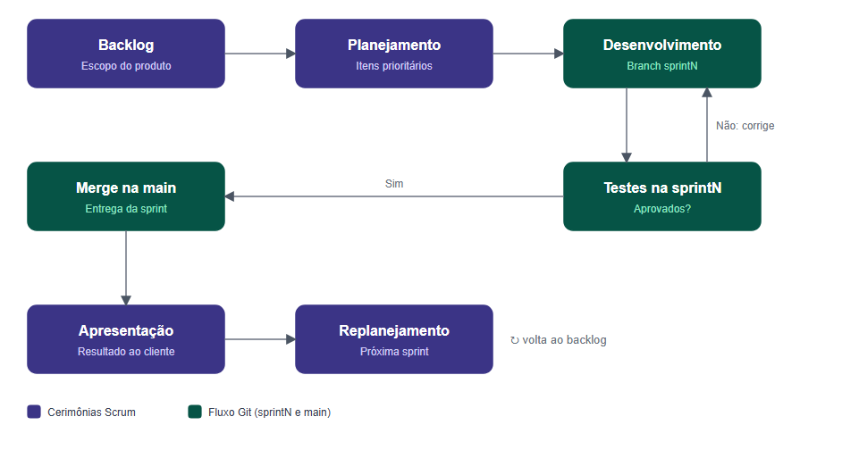

# Visão do Projeto

Resumo do documento *CoLecture: Visão do Produto e do Projeto*, **versão 1.2**.

## Histórico de revisões

| Data | Versão | Descrição | Autor |
| :--: | :----: | --------- | ----- |
| 24/09/2026 | 1.0 | Criação do documento com visão do produto, projeto, escopo e backlog inicial | Grupo Hamilton |
| 07/10/2026 | 1.1 | Padronização da política de branches (`sprintN`), correção de siglas de cenários e dos níveis de teste | Ricieri |
| 09/11/2026 | 1.2 | Correções após as considerações do professor na correção | Ricieri |

## Ciclo de vida

A equipe adota um ciclo de vida ágil baseado no **Scrum**, complementado por práticas do **XP (Extreme Programming)**. O projeto tem várias funcionalidades e a experiência do usuário é foco principal, o que exige validações frequentes e ajustes ao longo do caminho, algo que um modelo sequencial não permite com facilidade.

- Sprints de **7 dias**, com reuniões rápidas de alinhamento, reunião de revisão (o cliente avalia a entrega) e retrospectiva.
- Cada funcionalidade é implementada, testada e avaliada antes do fim da sprint; o backlog é atualizado a cada ciclo.
- Requisitos descritos do ponto de vista de quem os usa e priorizados em **Must, Should e Could**.
- Comunicação por Teams ou Discord e versionamento no GitHub.

## Processo de desenvolvimento

O Scrum organiza o trabalho em ciclos curtos com cerimônias definidas, apoiado no empirismo e no lean thinking. O XP contribui com comunicação clara, trabalho em equipe e feedback do cliente. O processo começa no backlog do produto e se repete a cada sprint: a equipe seleciona os itens de maior prioridade, implementa, testa, apresenta ao cliente e replaneja.

### Fluxo de trabalho Git

Uma branch para cada sprint, nomeada `sprintN` (`sprint1` a `sprint7`), onde o desenvolvimento é feito e integrado. A `main` é a branch final de entrega: tudo é testado na `sprintN` e, após a confirmação dos testes, a `sprintN` é integrada à `main` ao final da sprint.

*Figura 2 - Fluxo de trabalho planejado. Fonte: elaborado pelos autores (2026).*

## Organização do projeto

| Papel | Atribuições | Responsável | Participantes |
| ----- | ----------- | ----------- | ------------- |
| Desenvolvedor | Codificar o produto e os testes unitários, refatorar | Ana Clara e Henrique | Ana Clara, Henrique, Letícia, Jônatas, Arthur, Ricieri, Guilherme, Gabriel |
| Dono do Produto | Atualizar o escopo, organizar as sprints, validar entregas | Ricieri | Letícia, Arthur, Ricieri |
| Arquiteto de Software | Definir arquitetura, tecnologias e padrões, orientar decisões técnicas | Arthur Miguel | Arthur, Henrique |
| Analista de Requisitos e Documentação | Levantar, analisar e documentar requisitos, manter a documentação atualizada | Jônatas | Jônatas, Arthur |
| Analista de Qualidade | Garantir a qualidade e o conceito de pronto, realizar inspeções de código | Letícia | Letícia, Ricieri, Gabriel |
| Engenheiro de Dados | Projetar, organizar e manter a estrutura dos dados | Guilherme | Guilherme, Ricieri, Ana Clara, Gabriel |

## Planejamento das sprints

| Sprint | Entrega | Início | Fim | Entregáveis | Conclusão |
| :----: | ------- | :----: | :-: | ----------- | :-------: |
| 1 | Cadastro e gerenciamento de usuário | 07/10/2026 | 14/10/2026 | R01 a R04 | 100% |
| 2 | Gestão de catálogo e avaliação de livros | 15/10/2026 | 21/10/2026 | R05 a R08 | 100% |
| 3 | Manter comunidades | 22/10/2026 | 28/10/2026 | R09 e R10 | 0% |
| 4 | Metas de leitura e fóruns | 29/10/2026 | 04/11/2026 | R11 a R14 | 0% |
| 5 | Acompanhamento de progresso e ofensivas | 05/11/2026 | 11/11/2026 | R15 a R18 | 0% |
| 6 | Conquistas, recomendações e testes | 12/11/2026 | 18/11/2026 | R19 a R22 | 0% |
| 7 | Ajustes finais e apresentação | 19/11/2026 | 25/11/2026 | R23 | 0% |

!!! note
    As porcentagens de conclusão refletem o estado registrado na versão 1.2 do documento (09/11/2026).

Além das sprints, o cronograma prevê dois marcos de controle:

- **11/11/2026, ponto de controle:** release com cadastro, catálogo, comunidades, metas, fóruns e acompanhamento de leitura (R01 a R18), encerrando a Sprint 5.
- **16/11/2026, inspeção de qualidade:** conduzida pelo analista de qualidade sobre o código e as funcionalidades entregues. Os reparos são tratados na Sprint 7, antes da apresentação final.

## Comunicação

| Descrição | Envolvidos | Periodicidade | Produtos |
| --------- | ---------- | ------------- | -------- |
| Acompanhamento das atividades, riscos, compromissos e indicadores | Equipe do projeto | Semanal | Ata de reunião, relatório de situação |
| Comunicar a situação do projeto | Equipe e professor/monitor | Semanal | Ata de reunião, relatório de situação |
| Comunicação rápida e alinhamentos | Equipe do projeto | Conforme necessidade | Mensagem |

Ferramentas: Teams/Discord para reuniões e WhatsApp para comunicações rápidas.

## Gerenciamento de riscos

O grau de exposição combina a probabilidade do risco com o seu impacto. Os níveis alto, médio e baixo foram definidos por consenso da equipe, e não por cálculo numérico; riscos de exposição alta têm prioridade nas ações de prevenção e contingência.

| Risco | Exposição | Justificativa | Prevenção | Contingência |
| ----- | :-------: | ------------- | --------- | ------------ |
| Atraso na entrega por falta de tempo dos membros | Alto | Os integrantes cursam outras disciplinas e o cronograma de sete sprints de sete dias é curto | Sprints curtas com escopo reduzido e tarefas conforme a disponibilidade real | Redefinir prioridades, movendo requisitos menos prioritários para sprints posteriores |
| Saída ou inatividade de um membro | Médio | Probabilidade baixa em período curto, mas impacto relevante, pois algumas funções se concentram em poucos integrantes | Documentação do código atualizada e revisão de código em pares | Redistribuir tarefas essenciais e ajustar o escopo |
| Dificuldade técnica com banco de dados ou integração | Médio | O SQLite é simples, mas a integração entre models, views e fóruns pode gerar erros | Testes de integração e das principais rotas logo no início das sprints | Usar dados simulados nas demonstrações |
| Bugs críticos perto da entrega final | Alto | O prazo entre a inspeção e a entrega final é curto, com pouco espaço para correções e retestes | Testes contínuos de qualidade em todas as sprints | Priorizar login e cadastro e desativar recursos secundários com falha |
| Falta de familiaridade com as tecnologias | Médio | Parte da equipe tem pouca experiência com Django e com as práticas do Scrum e do XP | Estudos prévios e alinhamentos técnicos no início de cada funcionalidade | Apoio dos monitores e professores e reatribuição de tarefas |

## Critérios de replanejamento

- **Atraso no cronograma:** taxa de conclusão inferior a 70% ao final de uma sprint; o escopo das sprints seguintes é reavaliado.
- **Riscos mapeados:** se um risco de exposição alta se concretizar, as tarefas são redistribuídas conforme o plano de contingência. Riscos médios ou baixos seguem o planejamento ordinário.
- **Ajuste interno de prioridades:** requisitos Should ou Could são adiados em favor de funcionalidades essenciais.
- **Incompatibilidade técnica:** se uma tecnologia ou integração for inviável no prazo, adota-se solução alternativa.

A cada revisão de sprint a equipe confere esses critérios e, se necessário, atualiza e versiona este documento no repositório.
